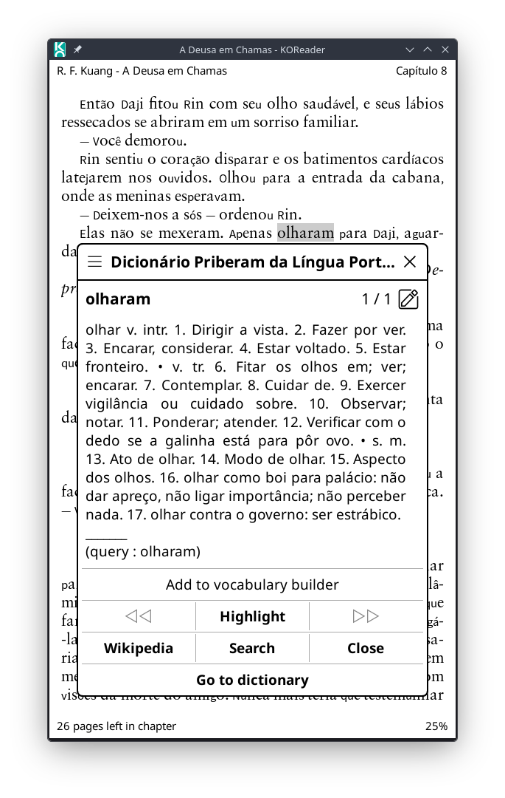
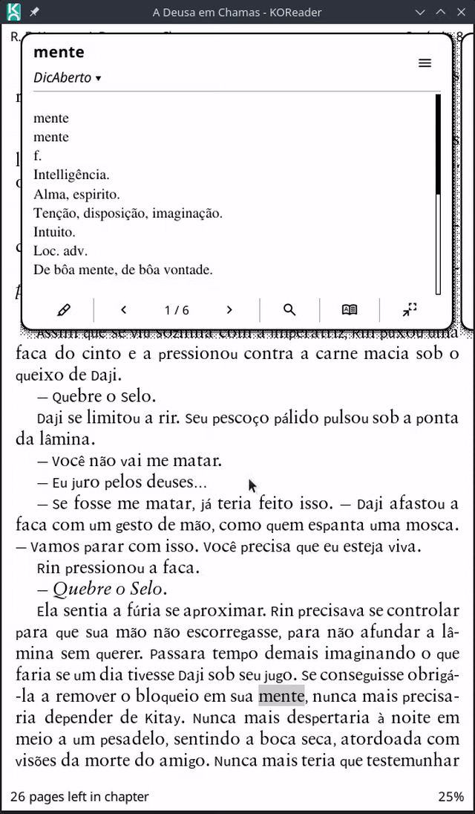
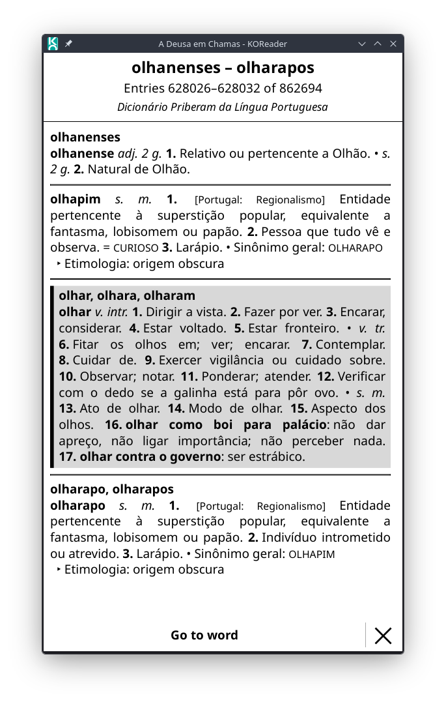
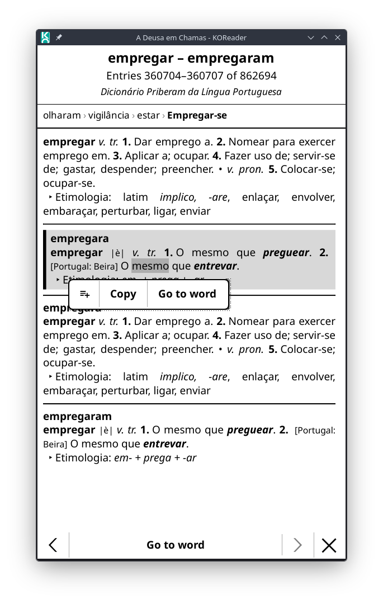
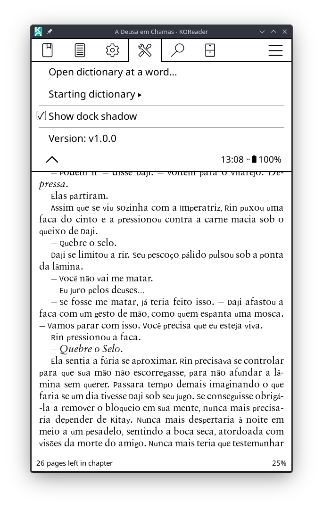

# Dictionary Explorer 

**Dictionary Explorer** adds a **Go to dictionary** button to KOReader's dictionary popup. It opens the dictionary at the word you looked up, in a full-screen viewer where you can keep paging through the neighbouring entries like a book, similar to the Kindle's "go to dictionary". While each page shows one dictionary, finding a word works as if all your dictionaries were one: a word missing from the one on screen is looked for in the others.

The viewer is a plain widget, not a document. Nothing is loaded through the reader, so the dictionary never shows up in **History**, never replaces your "last book" or "Continue reading", and leaves no `.sdr` sidecar folder or reading statistics behind. Closing it puts you right back where you were in your book.

## Requirements

- KOReader **v2026.07 or newer**. The button is added through the dictionary button API introduced in that release ([koreader#15184](https://github.com/koreader/koreader/pull/15184)), which older versions don't have. There, the plugin loads, logs a warning and adds nothing.
- StarDict dictionaries with 32-bit offsets and a `sametypesequence` of `m` (plain text), `h` (HTML) or `x` (XDXF-lite text, as in the Dicionário Aberto), stored as `.dict` or dictzip `.dict.dz`. Other dictionaries simply don't get the button, and are not among the dictionaries a word is looked for in.
- Complete files. A dictionary whose files were cut short (for example by an interrupted copy to the device) doesn't get the button either, or, when that only shows while its index is prepared, says that its files look incomplete and stops offering the button for the rest of the session. Copying it again fixes it.

## Installation

Copy the plugin folder to KOReader's `plugins` directory:

```text
dictionaryexplorer.koplugin/
├── _meta.lua
├── main.lua
├── dictionaryexplorer_l10n.lua
├── icons/
│   ├── add_word.svg
│   └── remove_word.svg
└── modules/
    ├── breadcrumb.lua
    ├── choicelist.lua
    ├── dock.lua
    ├── fitmodel.lua
    ├── inflate.lua
    ├── library.lua
    ├── notices.lua
    ├── readingsettings.lua
    ├── spelling.lua
    ├── stardict.lua
    ├── text.lua
    ├── trail.lua
    └── viewer.lua
```

The final path should look like this:

```text
koreader/plugins/dictionaryexplorer.koplugin/
```

Then restart KOReader.

## Opening the viewer

- **From a lookup.** Look up a word in a book as usual, and in the dictionary popup tap **Go to dictionary**. It is added as its own row at the bottom, and you can move or hide it in **Customize buttons** in KOReader's dictionary settings. If you use **Dictionary Preview**, the button is in the full popup that its details button opens, not in the compact preview.
- **At a word you type.** **Tools > Dictionary Explorer > Open dictionary at a word…** asks for a word (the dictionary it will use is shown under the title) and opens the viewer there. It works in the file browser as well, with no book open. The same action is registered with KOReader's Dispatcher as **Dictionary Explorer: open at a word**, under **General** in the action lists: assign it to a gesture in **Settings > Taps and gestures > Gesture manager** (or in a profile), or pick it in Quick Dock's action picker (Quick Dock shows a two-letter abbreviation for it unless you give it a custom icon in its settings). Which dictionary it opens is set in **Tools > Dictionary Explorer > Starting dictionary**: **Automatic**, the default, uses the first dictionary that can be opened in KOReader's own dictionary order (the order and the enabled state you set in KOReader's dictionary settings), or you can pick one; a dictionary that is no longer installed falls back to Automatic.
- **Where you left off.** See **Continuing an exploration** below.

Either way, if the dictionary has no entry for the word, the viewer opens in the one that has it, saying so (see **Finding words**).

### Continuing an exploration

The viewer keeps where you are as you go: the dictionary and page you are on, the highlighted entry and the latest 50 words of the breadcrumb, each with its dictionary. There is one exploration, the last one, whichever dictionaries it went through. It only changes KOReader's settings in memory (KOReader writes them out when it saves its settings), so it costs no file writes and no screen refreshes.

- **Continue exploring** reopens the dictionary you were in on the very page you left, with its breadcrumb (still going through the other dictionaries) and the word you were on. It is in **Tools > Dictionary Explorer** (dimmed until a dictionary has been explored), as the **Continue** button of the **Open dictionary at a word…** dialog, and as the **Dictionary Explorer: continue exploring** action for gestures, profiles and Quick Dock.
- Opening the viewer in any other way (**Go to dictionary**, a word you type) starts a new exploration, which then becomes the one to continue.
- If the dictionary was updated or replaced since (it has another number of entries, or another entry where the page started), it reopens at the word you were on instead, with a new breadcrumb. A word of the breadcrumb in another dictionary that changed is looked for again, by the word, when you go to it; one whose dictionary is no longer installed is left out.
- What version 1.4.0 kept (a place for each dictionary) is continued once, from the dictionary explored last, and then replaced.

### From other plugins

Other plugins can open the viewer at a word through the plugin object, `ui.dictionaryexplorer`: `canOpen(dictionary_name)` says whether a dictionary can be opened, and `openWord(dictionary_name, word, definition)` opens it at the word (`definition` is optional and only picks between entries with the same headword). Lookup Preview uses this for its **Go to word** button.

## Reading

The viewer opens on a page with the word's entry in the middle of the screen, highlighted (grey block with a heavy bar on its left), with the entries before and after it around it. A page holds as many consecutive entries as fit on the screen, so you read on through the dictionary rather than one word at a time.

- Swipe left / right, tap the left or right side of the text, or use the page-turn keys, for the previous / next page.
- Scroll an entry longer than the screen with taps on the left / right side of the text, swipes up / down, or the page-turn keys. Reaching the end of a page carries on into the next one, and the start of a page back into the previous one.
- Tap the **✕** at the bottom, or press the Back key, to return to your book.

### Several entries per page

- When a page has more than one entry, each is introduced by its headword in bold, unless the dictionary already starts its definitions with it (Priberam Portuguese and the Oxford dictionary do).
- Consecutive entries with identical text (Priberam Portuguese stores every inflected form as its own entry, for example `cartadazona`, `cartadazonas`, `cartadinha`) are shown once under a shared heading.
- If keeping the entry centred would leave a lot of the screen empty (the entry on one side is too big to fit), entries are added on the other side instead until the page is full, so the entry may end up nearer the top or bottom.
- The entry is centred as well as the whole entries around it allow: entries are never cut, so a very large neighbour can leave it a little above or below the middle, and near the start or end of a dictionary there is nothing to put above or below it.
- An entry that is longer than the screen on its own (for example `casa` in Priberam Portuguese) takes the whole page, so it can't be centred, and it isn't highlighted since nothing else is on the page; the title names it. Very long entries, such as the Oxford entry for `house`, scroll.
- How many entries a page holds is measured, not guessed: the page is laid out, and if there is room left, more entries are added, or entries are dropped again if it spills onto a second screen, until it is about 90% full or more. A small model of how tall entries are (fitted by least squares to the heights that were measured, and started from a sample of the dictionary's own text) predicts how many will fit, so that usually a single layout is needed (about 1.5 per page).
- An entry is never split across pages, and a page with several entries never scrolls. When the next entry doesn't fit in what is left, the page simply ends there, so it can have some blank space at the bottom.
- Paging backwards builds the page that ends right before the current one, so pages always follow each other with no entry skipped or repeated. Going back does not necessarily land on the same page boundaries you came forward through.

### The header

In large bold type, the first and last headword of the page, then the entry numbers ("Entries 14390–14396 of 45866") and, in italics on a line of its own, the name of the dictionary. After the name, when other dictionaries have the highlighted word too, which of them this one is: "· ‹ 1/3 ›" (see **All the dictionaries as one**). The header is also tappable: the name's line goes to the same word in another dictionary, the rest lists the dictionaries that have it.

The **compact header** (in the dictionary appearance, below) is one line instead: the page's headwords on the left, and on the right the dictionary's short name ("PT") with "‹ 1/3 ›", leaving two lines more for the entries. Tapping the name's part goes to the word in another dictionary (its left half the previous one, its right half the next one); tapping the headwords lists the dictionaries. In a mirrored (right-to-left) layout the two parts swap sides, and so do the places to tap.

### The buttons at the bottom

One row: a gear for the **dictionary appearance** (below), **Search**, the only bold label (hold it to see what it does), which takes all the width the other buttons leave, and a narrow **✕** that closes the viewer. There are no back and forward buttons (the breadcrumb is for that) and no page buttons.

### Dictionary appearance

The gear left of **Search**, or **Tools > Dictionary Explorer > Dictionary appearance…**, opens one dialog for how the dictionary looks:

| Setting | Unless set | Steps |
|---|---|---|
| **Font size** | follows the system (KOReader's dictionary settings) | − / +, 12 to 40 |
| **Line height** | 1.3 | − / +, 1.0 to 2.0 |
| **Margins** (left and right) | follow the book (see below) | − / +, 0 to 60 |
| **Justified** | follows the system | tap: follows the system, yes, no |
| **Header** | full | tap: full, compact (one line) |

Changing a value redraws only the dialog; nothing else changes until **Apply**, which keeps the values and lays the page out once more with them, on the same entry. **Cancel** leaves everything as it was, and **Defaults** goes back to what each follows. A margin so large it would leave little room for the text is held at 30% of the screen's width on each side.

### Margins

Unless set in the dictionary appearance, the left and right margins of the book you were reading are applied to the dictionary text, so it lines up with your book. Only EPUB, TXT, HTML and other documents that KOReader lays out itself (crengine) have such margins. For PDF, CBZ and other fixed-layout documents, or when the dictionary is opened from the file browser, a small default margin is used. The title bar and buttons always use the full screen width.

## Finding words

There are three ways to go to a word, and all find it the same way:

- **Search**, the button at the bottom: type a word, and a list shows what every dictionary has for it (see below);
- **long-press a word** in an entry (or drag from its first to its last word for a phrase): the selection dock's **Go to word** goes to it (see **The selection dock**);
- **tap a link** inside an entry (`bword://…`).

The target is centred and highlighted, like the word the viewer opened on.

### How a word is found

- **Case** is ignored for every letter, accented ones included: `ÁRVORE` or a sentence-initial `Pêssego` find `árvore` / `pêssego`, `óbidos` finds `Óbidos`; when the text as given is a headword itself (`Árvore`, a name), that one wins.
- **Inflected forms and variants**: a word that is not a headword but is in the dictionary's synonym file (`.syn`, as in the Shorter Oxford, where `abomining` leads to `abomine`) goes to the entry it belongs to; the breadcrumb keeps the word you asked for. A headword always wins over a word of the `.syn`.
- **Accents**: a word typed without them finds the entry that has them (`acao` opens `ação`, `pessego` `pêssego`, `obidos` `Óbidos`). This is only tried when the word has no entry of its own, in any case or through the `.syn`, so an entry spelled exactly as typed always wins.
- **Other dictionaries**: a word with no entry in the dictionary on screen is looked for in the others, by a priority set out in **All the dictionaries as one**.
- **Phrases**: punctuation around a selection is ignored, and a phrase that is not an entry by itself goes to its first word.
- **Nothing anywhere**: the closest entry in the dictionary on screen is shown.

### The line above the entries

When the word shown is not exactly the one asked for here, a line in italics above the entries says so:

| Line | When | Tap it |
|---|---|---|
| "No entry for “casa” in EN-PT. Found in PT." | Another dictionary has it, and the viewer went there | — (the word was found; the others that have it are in the header) |
| "No entry for “acao” in EN. Showing “ação” from PT." | Another dictionary has it with accents | — |
| "No entry for “etica”. Showing “ética”." | Only an accented spelling here | For suggestions (there may be several spellings) |
| "No entry for “casaz”. Showing the closest one." | No dictionary has it | For suggestions |

The line is part of the page, so it costs no refresh of its own, and it goes away with the next page or word. A long text (a pasted paragraph) is cut to its first 60 characters, and the line to two lines, so the entries keep their room.

### Suggestions

For a word with no entry anywhere (a typo, a word cut short) or only with accents here, tapping the line lists, one row per word: this dictionary's accented spellings and the entries around where the word would be, then up to three entries of each other dictionary, the ones spelled most like it (sharing the longest beginning with it, accents and case aside, and at least its first two letters: `casado`, `casaco`, `casa` for `casaz`). Each row names the dictionaries that have the word when the list has more than one (`casa · PT, EN-PT`). The one chosen takes the place, in the breadcrumb, of the word that had no entry.

### Search

**Search** asks for a word (the dialog says where it looks, and so does holding the button) and lists what every dictionary has for it, one row per word with the dictionaries that have it, this one first: `sofa · EN-PT, EN` and `sofá · PT`. A row opens the entry it found, in the first of its dictionaries (this one when it has it), even when it is one of several entries with the same headword; the header's mark then goes to the others. When no dictionary has the word, the list has the entries closest to it instead, as the suggestions do. A dictionary whose index was never prepared is listed as "(index not prepared yet)", and choosing it prepares it. Nothing is redrawn but the list until you choose.

### The lists

The suggestions, Search's results and the list of dictionaries the header opens show six choices at a time, never the whole screen, with the page in their title ("(1/2)") and a row at their foot: **‹** and **›** turn their pages (every page is as big, so a turn refreshes only the list's area, even where you dragged it) and **✕** closes them without a choice, as tapping outside them does. Choosing a word redraws the page once.

## All the dictionaries as one

The dictionaries complement each other: `house` in the English–Portuguese dictionary is explained with `casa`, whose meaning is in the Portuguese one, and the Oxford tells more about `house` itself. So, while each page shows one dictionary and turns through it, finding a word works as if all of them were one big dictionary. Every enabled dictionary takes part, in the order of KOReader's dictionary settings.

- **Priority.** A word goes to its exact entry in the dictionary on screen (in any case, or through the `.syn`); else to an exact entry in another dictionary; else to an accented spelling here; else to an accented spelling in another; else to the closest entry here. This applies to the selection dock's **Go to word**, links, **Open dictionary at a word…** and the popup's **Go to dictionary**. When the word is here, nothing else is read, so going to it costs what it always did.
- **The header** says, after the dictionary's name, which of the dictionaries that have the highlighted word this one is: "Priberam English - Portuguese Dictionary · ‹ 1/3 ›". **Tap the right half of the name's line** to see the same word in the next one (after the last, the first again), **its left half** for the previous one (before the first, the last), as taps on the text turn pages; the switch takes the place of the word in the breadcrumb rather than adding it again. Tap the rest of the header to list them instead (`casa · PT`, `casa · EN`…). The mark goes once the highlighted entry is off the page; the name gives way to it when both don't fit, and the header keeps its height.
- **The breadcrumb** names each word's dictionary when it goes through more than one (`house · EN-PT › casa · PT`); tapping a word takes the viewer back to its dictionary.
- **Short names** ("EN-PT", "PT", "EN") are made from the dictionaries' names: the languages they mention, or a word of the name too when that doesn't tell two apart. Change them in **Tools > Dictionary Explorer > Short names of the dictionaries**.
- **Preparing.** A dictionary whose index was never prepared (never opened here) can't be asked, so it is left out of the search for a word until it is; the lists show it as "(index not prepared yet)", and choosing it prepares it. **Tools > Dictionary Explorer > Prepare all dictionaries** prepares them all at once, so that none is left out.
- **Dictionaries added, removed or copied again in their place** while KOReader runs are seen as they are without restarting: the folders are scanned again each time the viewer opens, when a menu or the starting-word dialog lists the dictionaries, and when the popup shows a dictionary it doesn't know yet; a dictionary whose files changed (their size or date) is read anew, nothing of the old one kept. The starting-word dialog checks its dictionary again when you tap **Open**: removed meanwhile, the starting dictionary as it is then is used.

## The breadcrumb

Once you start walking through the dictionaries (with **Search**, the selection dock's **Go to word** or a link), a breadcrumb appears at the top of the viewer, right under the header and above the first entry, showing the words you went through, oldest first, with the word you are on in bold (the latest one, until you tap an earlier one):

`… › responsabilidade › gato › mesa › **extraordinariamente**`

- It uses the whole width of the page, with a rule above it that separates it from the entries and one below it that separates it from the buttons. Words that don't fit are replaced by `…`, and the latest word is always shown.
- **Swipe right** on it to see the earlier words (swipe left to come back towards the latest). One word stays in view across each swipe, and tapping a `…` does the same. When a swipe reaches the first word of the trail, the rest of the line is filled with the words that come after it (`responder › aperto › socorro › arroba › pedaço › laranja › …`), so there is never room wasted before the closing `…`.
- **Tap a word** to go to it, in its dictionary. It becomes the bold one, and nothing else changes: the same words stay on screen, in the same order, so you can hop back and forth along your path. Which words fit is worked out with the bold width of every word, so bolding a different word never pushes another out of view.
- Going to a *new* word after going back replaces whatever came after the word you were on, like a browser's history: with `casa › livro › amor` and you on `livro`, looking up `zebra` gives `casa › livro › zebra`.
- Paging, swiping or scrolling does not change it. The first word is the one the viewer opened on, and the breadcrumb only appears once there are two words. While it is shown, pages have one line less of room for entries.
- When it goes through more than one dictionary, each word has its dictionary's short name (`house · EN-PT › casa · PT`).

## The selection dock

Long-press a word (or drag over a phrase) to select it. A small dock appears next to the selection, centred below it, or above it when there is no room below inside the text, and disappears when you tap anywhere else (the selection is cleared too):

- **Go to word** goes to the word, as described in **Finding words**: here if this dictionary has it, in another one otherwise.
- **Copy** copies the selected text to the clipboard, for a single word as well as for a phrase.
- For a single word, an icon first, on the left: **Add to vocabulary builder**, when KOReader's *Vocabulary builder* plugin is enabled. It does what the dictionary popup's button of that name does (the word is stored with the title of the book you came from). The icon says what it will do: `icons/add_word.svg` when the word is not in the builder yet, `icons/remove_word.svg` when it is, in which case tapping it asks for confirmation and removes the word. It is an icon because the full name does not fit next to the other two buttons, especially in Portuguese; **hold it** to see what it does. Adding shows a brief "Added to vocabulary builder." note. The builder's option to store the context of a word is not used here: the viewer has no book sentence to give it.

The dock is drawn like the toolbar of the Selection Toolbar plugin, so both look alike: the same rounded frame and uniform border, buttons of the same height separated by a light grey rule, and the same dithered shadow along the right and bottom edges. Its text buttons have more room on the sides than that toolbar's icon buttons. It stays next to the selection: unlike other KOReader dialogs it can't be moved, so holding one of its buttons doesn't send it to the middle of the screen.

## Configuration

Open the top menu and go to **Tools > Dictionary Explorer**:

- **Open dictionary at a word…** and **Continue exploring**: see **Opening the viewer**.
- **Starting dictionary**: which dictionary **Open dictionary at a word…** opens.
- **Dictionary appearance…**: font size, line height, margins, justification and the header (see **Dictionary appearance**).
- **Prepare all dictionaries**: prepares the index of every enabled dictionary that has none, so that the search for a word asks them all, and removes the indexes of dictionaries no longer installed.
- **Short names of the dictionaries**: the names the breadcrumb and the lists give them; tap one to change it, or leave it empty for the one made from its name.
- **Show dock shadow**: shows or hides the dithered shadow of the selection dock. It is on by default, and is independent of the Selection Toolbar's own shadow setting.
- **Version**: shows the installed plugin version.

## How it works

`sdcv`, which KOReader uses for lookups, can only answer "what does this word mean?", not "what is the entry after this one?". Dictionary Explorer therefore reads the dictionary's `.idx` itself.

- The first time a dictionary is opened, the `.idx` is scanned once (a notice is shown) and the offset and key of every 64th entry are cached in `cache/dictionaryexplorer/` inside KOReader's data folder. Only those keys and a handful of recently read pages are kept in memory, so dictionaries with hundreds of thousands of entries are fine. The cache is rebuilt automatically if the `.idx` changes.
- Each cache file is named after the dictionary's file and a short hash of its full path, so two dictionaries with the same file name in different folders never share one. It is written to a temporary file and then renamed, so an interrupted write can't leave half a cache, and a cache that doesn't add up is ignored and rebuilt. The caches of dictionaries no longer installed are removed by **Prepare all dictionaries** (not by themselves: a dictionary on a memory card that is not mounted would lose its cache).
- The files are checked before they are used: the `.idx` must be the size the `.ifo` says, hold the number of entries it says, and end on a whole record, and the `.dict` or `.dict.dz` must hold everything the `.idx` points into (for a `.dict.dz`, by its real uncompressed size, from a chunk table that is checked before it is read). The last check is repeated each time the cache is loaded, so a dictionary whose definitions are later replaced by a shorter copy is caught too.
- Lookups binary-search those keys and read a single 64-entry page. Some dictionaries are not sorted the way the StarDict specification says (the Priberam Portuguese one is in plain byte order), so both orders are tried.
- The synonym file (`.syn`), when there is one, is indexed and cached the same way. It is optional, so one that is damaged (cut short, with another number of words than the `.ifo` says, or leading past the last entry) is left aside, and the dictionary works without it. It makes the cache bigger (the Shorter Oxford's grows from about 90 KB to 400 KB) and indexing a little longer.
- Definitions are read straight from `.dict`, or from `.dict.dz` by decompressing only the chunks an entry spans.
- Some dictionaries index inflected forms under their own key (Priberam Portuguese has an entry `livro` whose text is the entry for `livrar`). The viewer shows the dictionary's real order, so the title is the index key and the text is whatever the dictionary stores for it.
- Entries are rendered with the dictionary's own `.css` and `.lua` HTML fix, like KOReader's popup. For plain-text dictionaries the basic inline tags (`<b>`, `<i>`, `<big>`, `<small>`…) are kept instead of stripped.

## Performance and battery

- **Nothing runs in the background.** The plugin has no timers, polling or listeners beyond KOReader's own events; when the viewer is closed it costs nothing but the memory of what was loaded (about 120 KB of code and, per dictionary opened, the index below).
- **First use of a dictionary** scans its `.idx` once and caches a compact index (`cache/dictionaryexplorer/`). On a desktop that takes about 70 ms for a dictionary with 860 thousand entries (the time on an e-reader is dominated by reading the file); afterwards loading the cache takes a few milliseconds.
- **Opening the viewer or going to a word** costs a few milliseconds of CPU on a desktop, and a page turn about 2 to 3. A word missing from the dictionary on screen also asks the others (a millisecond or two each), loading their caches the first time in a session. The exception is a very long entry (the Oxford entry for `house` has 186 KB of HTML), which takes the layout engine a fraction of a second: the whole entry is laid out.
- **The screen is refreshed once per action** (page turn, going to a word, going to the same word in another dictionary, scrolling the breadcrumb, applying the dictionary appearance, with no repeated refreshes), which is what an e-ink display costs the most battery for. Lists and the dictionary appearance's dialog refresh only their own area. Closing the viewer does one full refresh, as KOReader does when closing a document.
- **A long exploration costs no more per page.** Where the exploration is (to continue it later) is kept after every page, with the last 50 words of the breadcrumb, but each word's entry is read once, not on every page; the short names the breadcrumb and the header show are worked out from the dictionaries' names once. A page turn with 50 words through several dictionaries in the breadcrumb opens as few files as one with none.
- While a page is being built, the definitions file is opened once and each entry's HTML is read once, however many layouts are tried; the file and the inflated chunks of compressed dictionaries are released when the viewer closes or goes to another dictionary.

## Known limitations

- The plugin is tested with the dictionaries the author uses (Priberam Portuguese and English–Portuguese, the Shorter Oxford English Dictionary 6th Ed. and the Oxford English Dictionary 2nd Ed., Dicionário Aberto, a Portuguese–English dictionary and a WikDict English–Portuguese), and with synthetic dictionaries of each shape it supports; other StarDict dictionaries of the same shape should work but are untested.
- Type `x` is read as the simple XDXF that StarDict dictionaries use (`<k>` headword, `<b>`, `<i>` ...): the headword is shown in bold and the indentation and blank lines are tidied. Structured XDXF (`<def>`, `<gr>` ... ) is not converted: its tags are dropped and its text is kept.
- The viewer pages through headwords only: the words of the synonym file (`.syn`) lead to their entries, but are not pages of their own.
- Short names are made from the languages a dictionary's name mentions in English, Portuguese, Spanish, French, German and a few more; for others, a word of the name is used. They can always be changed by hand.

## Uninstalling

Remove the folder:

```text
koreader/plugins/dictionaryexplorer.koplugin/
```

Then restart KOReader.

Settings saved in KOReader may remain until manually removed from KOReader's settings storage, but they will not have any effect once the plugin is removed.

## Screenshots







