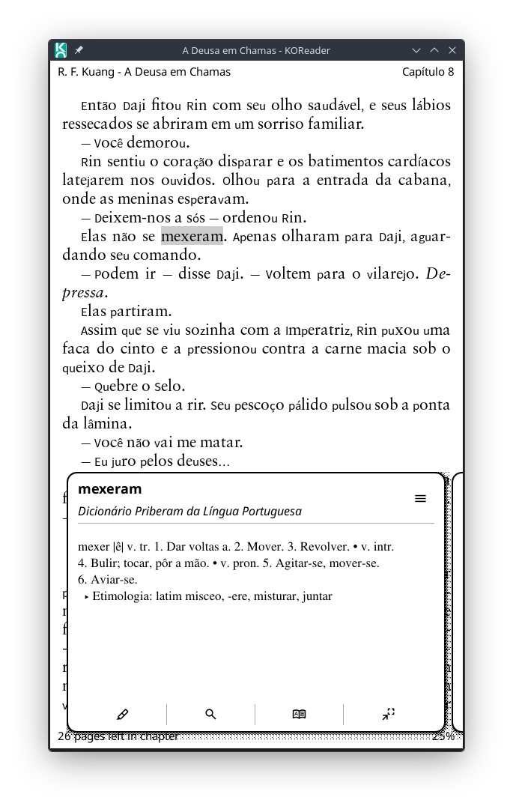
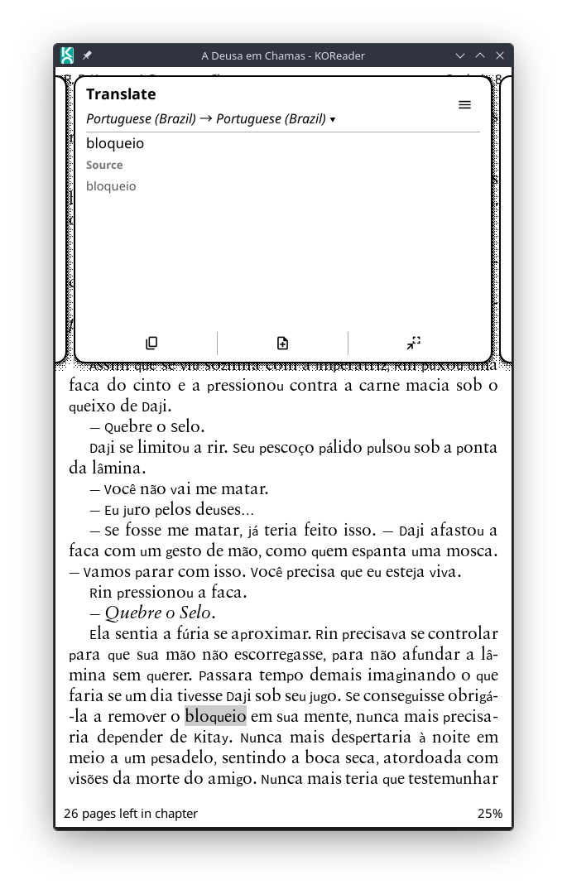
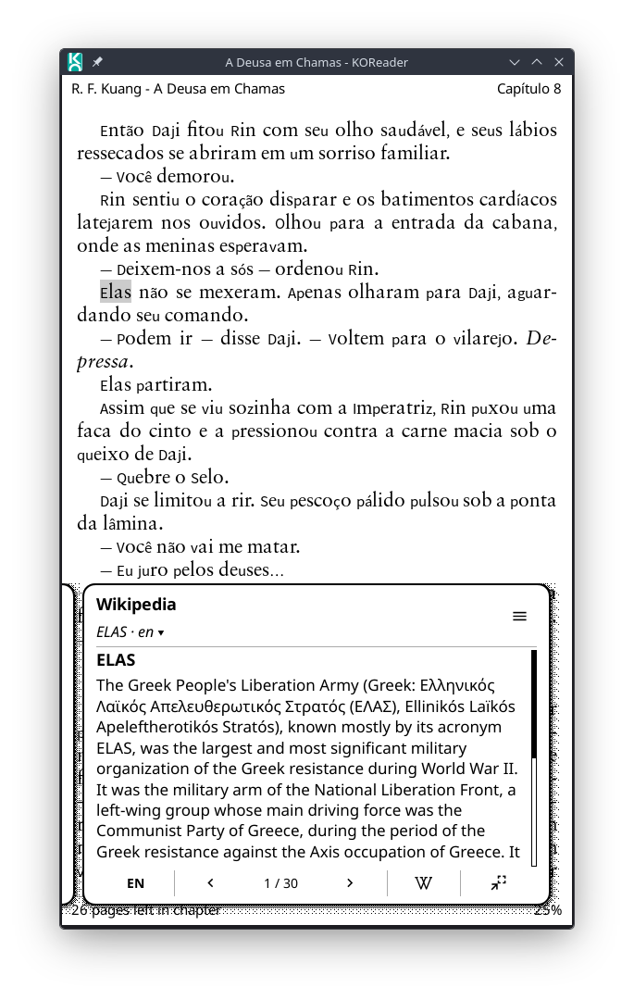
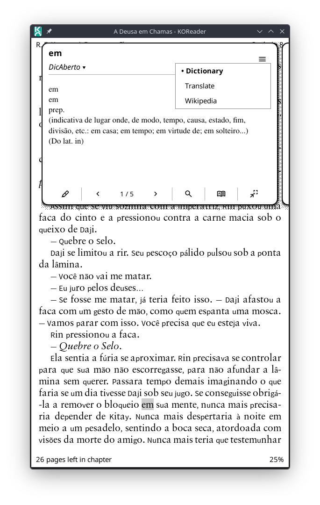
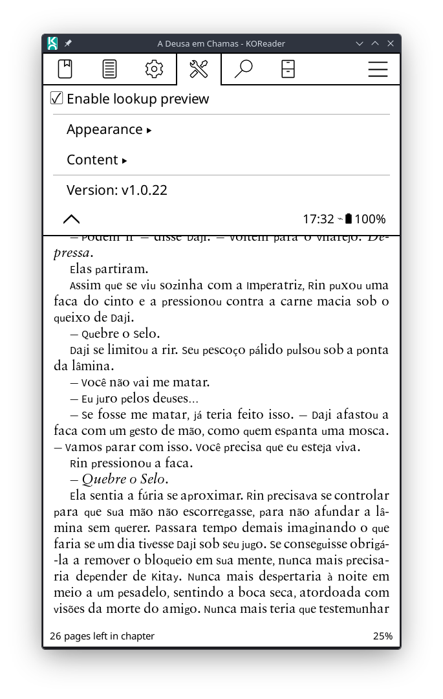

# Lookup Preview 

**Lookup Preview** is a KOReader reader plugin that changes the lookup flow for selected text. Instead of opening each native lookup window immediately, it first shows a compact floating carousel with preview cards for **Dictionary**, **Translate**, and **Wikipedia**.

The plugin keeps KOReader's original dictionary, translator, and Wikipedia views available from the preview cards, while making common actions such as switching dictionaries, changing the translation target language, selecting the Wikipedia language, copying translations, creating notes, and opening full articles accessible from the carousel itself.

The plugin metadata registers it as `lookuppreview` with the display name **Lookup Preview**. Its purpose is to provide a less intrusive, faster, and more unified lookup experience for selected text in the reader.

## Features

- Shows a floating carousel after selected text is sent to Dictionary, Translate, or Wikipedia.
- Provides three preview cards:
  - **Dictionary**, with definition preview and dictionary navigation;
  - **Translate**, with compact translation preview and target language selection;
  - **Wikipedia**, with article introduction preview and language selection.
- Opens the carousel directly on the card matching the action selected by the user.
- Supports horizontal swipes to move between Dictionary, Translate, and Wikipedia.
- Automatically positions the floating carousel near the top or bottom of the screen to avoid covering the selected text when possible.
- Uses a compact header: the card's name as title (tap it, `Dictionary ▾`, to choose another card) and what the card shows as subtitle.
- Keeps KOReader's original native lookup widgets available through compact action buttons.
- Uses lazy loading for Translate and Wikipedia cards, avoiding unnecessary network requests until those cards are opened.
- Looks the selected text up in the dictionary when the Dictionary card is first shown, also when the carousel was opened from Translate or Wikipedia, so every card works whichever action opened it.
- Remembers what Translate and Wikipedia answered for the rest of the KOReader session, so looking the same text up again (also in another book) shows the answer at once, with no network.
- Runs Translate and Wikipedia queries like KOReader does, so a tap cancels a slow query (except on macOS, see Known limitations).
- Adds an optional **Add to vocabulary builder** button to the dictionary card, like the one in KOReader's dictionary popup.
- Looks words up without leaving the carousel: tapping a link in a definition, holding a word of a card, or editing the looked up text opens a new lookup in the same carousel, and the header's back button returns to the previous one as it was.
- Expands the cards with a two-finger spread and makes them compact again with a pinch, with a setting for how tall they open and for the size of their text.
- Lets each lookup choose the language to translate from, and translate the whole sentence around the selection instead of the selection alone.
- Shows only the cards you want, in the order you want, and can open lookups from the book on the last card used.
- Works with page turn buttons and a D-pad: left and right change cards, page turn buttons and up/down scroll the card.
- Keeps each card where it was scrolled to while the lookup is open: each dictionary result, each translation language and each Wikipedia article has its own place, also shown on the side cards.
- Reuses the current popup while switching content, reducing unnecessary carousel rebuilds.
- Supports square and rounded card corners from the plugin settings.
- In tabbed mode, uses a square upper-left junction while Dictionary is active, restoring the rounded card corner and extending the Dictionary tab border to meet it on the other tabs.
- Avoids repeating the Translate and Wikipedia tab labels as card titles in tabbed mode, promoting their useful language and result controls to title styling.
- Uses matching dithered shadows along the right and bottom edges of each card, following the card radius in rounded mode while preserving square shadows in square mode.
- Is translated into Portuguese (Brazil and Portugal) when KOReader is in Portuguese; other languages use KOReader's own translations for the words it has, and English for the rest.
- Shows its messages (a word added to the vocabulary builder, a translation copied…) next to the carousel, where button hints appear, while it is open; KOReader's notifications are used when it is closed.
- Holding any button, the card's title, a clickable subtitle, or a side tab shows a short note saying what it does. The note appears centred on the card, just above it (or below when there is no room), and stays for five seconds after the finger is lifted; a tap or swipe dismisses it sooner.
- Adds a version entry in the plugin settings menu.

## Installation

Copy the plugin folder to KOReader's `plugins` directory:

```text
lookuppreview.koplugin/
├── _meta.lua
├── main.lua
├── lookuppreview_l10n.lua
├── icons/
│   ├── add_note.svg
│   ├── copy.svg
│   ├── edit_lookup.svg
│   ├── go_to_dict.svg
│   ├── highlight.svg
│   ├── load_online.svg
│   ├── loading.svg
│   ├── open_popup.svg
│   ├── retry.svg
│   ├── search.svg
│   ├── translate_selection.svg
│   ├── translate_sentence.svg
│   ├── vocabulary.svg
│   └── wikipedia.svg
└── modules/
    ├── carousel.lua
    ├── context.lua
    ├── core.lua
    ├── dictionary.lua
    ├── payload.lua
    ├── translation.lua
    ├── utils.lua
    ├── widgets.lua
    └── wikipedia.lua
```

The `icons/` folder contains custom SVG or PNG icons used by Lookup Preview action buttons. Local files take precedence over KOReader's system icons. Keep this folder inside `lookuppreview.koplugin/` together with the Lua files.

Expected primary filenames:

| Action | SVG | PNG |
|---|---|---|
| Highlight | `highlight.svg` | `highlight.png` |
| Full-text search | `search.svg` | `search.png` |
| Previous result | `chevron.left.svg` | `chevron.left.png` |
| Next result | `chevron.right.svg` | `chevron.right.png` |
| Open native details | `open_popup.svg` | `open_popup.png` |
| Go to word in Dictionary Explorer | `go_to_dict.svg` | `go_to_dict.png` |
| Add to vocabulary builder | `vocabulary.svg` | `vocabulary.png` |
| Copy translation | `copy.svg` | `copy.png` |
| Add translation note | `add_note.svg` | `add_note.png` |
| Full Wikipedia article | `wikipedia.svg` | `wikipedia.png` |
| Loading feedback | `loading.svg` | `loading.png` |
| Edit the looked up text | `edit_lookup.svg` | `edit_lookup.png` |
| Translate the whole sentence | `translate_sentence.svg` | `translate_sentence.png` |
| Translate only the selected text | `translate_selection.svg` | `translate_selection.png` |
| Load an online card | `load_online.svg` | `load_online.png` |
| Retry | `retry.svg` | `retry.png` |

The Highlight action also accepts `lookuppreview.highlight` and `dictionarypreview.highlight`; search also accepts `appbar.search`; and Full Wikipedia article also accepts `lookuppreview.wikipedia` and `dictionarypreview.wikipedia`, each with an `.svg` or `.png` extension. `open_popup` was called `read_more` in earlier versions, and a local `read_more.svg` or `read_more.png` is still accepted. If neither is present, Open native details falls back to KOReader's `chevron.up` icon. The edit button also accepts `edit.svg` or `edit.png`; if neither is present, it uses KOReader's `edit` icon; the back button uses `chevron.left`, like Previous result. If `vocabulary` is absent, Add to vocabulary builder falls back to KOReader's `plus` icon; once the word is added the button shows KOReader's `check` icon. Highlight, Go to word, Copy translation, Add translation note, Full Wikipedia article, Sentence, Load and Retry fall back to their text labels when their local icons are absent. Every button but the Wikipedia language code is an icon; holding it says what it does.

The same list is available on the device under **Lookup preview → Appearance → Custom icon filenames**.

The final path should look like this:

```text
koreader/plugins/lookuppreview.koplugin/
```

Then restart KOReader.

## Configuration

After restarting KOReader, open a book and go to the reader menu. The plugin adds a **Lookup preview** settings entry.

The menu contains:

- **Enable lookup preview**: turns the preview behavior on or off.
- **Appearance**:
  - **Display style**: **Carousel** (the default: the other cards are shown beside the active one) or **Tabs**;
  - **Corner style**: **Square** (the default) or **Rounded** card corners;
  - **Show card shadows**: enables or disables the dithered right and bottom shadows;
  - **Card height**: **Compact** (the default, about a third of the screen) or **Expanded** (three quarters of it). A two-finger spread on a card expands it and a pinch makes it compact again, for that lookup;
  - **Text size**: the size of the cards' content, from 14 to 24 (18 by default);
  - **Custom icon filenames**: lists every supported local SVG and PNG filename.
- **Content**:
  - **Cards**:
    - **Show and order cards**: shows, hides and orders the Dictionary, Translate and Wikipedia cards, in KOReader's sort dialog. A hidden card's action is left to KOReader: Translate hidden means Translate opens KOReader's own translator, and so on. At least one card stays shown;
    - **Open on the dictionary card** (the default) or **Open on the last card used**: which card a lookup from the book (a long press on a word) opens on. Translate and Wikipedia chosen in the selection menu always open on their own card;
  - **Online card loading**: **Automatic** (the default) or **Manual**;
  - **Dictionary**:
    - **Dictionary HTML**: selects formatted or fast/raw dictionary rendering;
    - **Buttons**, one checkbox each, all shown by default:
      - **Show KOReader popup button** and **Show Dictionary Explorer button**: the two buttons that open the full dictionary. One of them always stays checked, so there is always a way to the full entry; without Dictionary Explorer (it needs v2026.07 or newer KOReader), its checkbox is disabled and KOReader's popup cannot be unchecked. KOReader's popup is also shown for a dictionary Dictionary Explorer can't open;
      - **Show vocabulary builder button**: the **Add to vocabulary builder** button. It needs KOReader's Vocabulary builder plugin enabled, and is not shown when that plugin adds every looked up word by itself;
  - **Translate**:
    - **Target language**: selects the target language used by the Translate card;
    - **Show source text**: shows or hides the original selected text below the translation;
    - **Buttons**:
      - **Show copy button**: shows or hides the copy button;
      - **Show note button**: shows or hides the note button;
  - **Wikipedia**:
    - **Language**: selects the language used by the Wikipedia card.

  The general options come first; then each card has a submenu named after it, of the same shape: its own options and, in **Buttons**, the buttons it offers. Languages are shown by their names.
- **Version**: displays the version declared in `_meta.lua`.

By default, Lookup Preview and card shadows are enabled, the carousel uses square card corners, optional translation buttons follow the saved plugin settings, and Translate/Wikipedia languages are read from KOReader or plugin settings when available.

The **Load** (`load_online.svg`) and **Retry** (`retry.svg`) buttons are icons. In manual online-loading mode, a Translate or Wikipedia answer already in the session cache is shown as soon as its card opens, since it needs no network; anything else waits for **Load**. **Retry** always queries again, even when the answer is cached. Tapping **Load** or **Retry** immediately replaces that button with `loading.svg` before the Translate or Wikipedia request starts. If the custom loading icon is absent, the button displays **Loading…** instead.

## How it works

When selected text triggers KOReader's dictionary, translator, or Wikipedia action, the plugin intercepts the lookup flow before the native widget is opened. If Lookup Preview is enabled, it creates a floating carousel and opens the card associated with the selected action.

For example:

```text
Dictionary action  → opens carousel on Dictionary card
Translate action   → opens carousel on Translate card
Wikipedia action   → opens carousel on Wikipedia card
```

The original KOReader widgets remain available. Each card has a compact details/original-view action that closes the preview and opens the corresponding native KOReader interface for the same selected text.

Translate and Wikipedia are loaded lazily. This means the plugin does not query the translation service or Wikipedia until the corresponding card is opened. This keeps dictionary lookup fast and avoids unnecessary network calls.

The dictionary is loaded the same way when the carousel was opened from Translate or Wikipedia: the selected text is looked up when the Dictionary card is first shown (by swiping, a tab or the card's title), whatever the online loading setting, since the dictionary is local. The lookup goes through KOReader's own, so fuzzy search, the dictionaries enabled for the book and the lookup history behave as for a lookup from the book; the result fills the card instead of opening KOReader's window.

Each card can be in one of these states: not looked up yet, loading, showing its content, nothing found, or failed (with a **Retry** button).

## Dictionary card

- Shows the found word and the current dictionary name in the subtitle (`livro · Dictionary name ▾`).
- When the carousel was opened from Translate or Wikipedia, looks the selected text up the first time the card is shown. While it looks up, the card says so; a word in no dictionary shows **No definition found.**, and a lookup that did not finish offers **Retry**.
- Displays the dictionary definition inside a scrollable preview area.
- Supports multiple dictionary results.
- Shows the current dictionary result count in regular text between the Previous and Next footer arrows when more than one result is available, without dividers inside that navigation group. Highlight comes before the navigation group, followed by Search and the buttons that open the full dictionary (see below).
- Makes the subtitle clickable to open the dictionary result list.
- Lists dictionary results as:

```text
found word · dictionary name
```

- Provides compact action buttons:
  - **Highlight**: creates a highlight from the current selection when available;
  - **Previous / result count / Next**: switches between dictionary results when multiple results are available;
  - **Search**: opens KOReader's full-text search for the selected text;
  - **Details**: opens KOReader's original dictionary popup;
  - **Go to word** (`go_to_dict.svg`): when the [Dictionary Explorer](./dictionaryexplorer.koplugin.md) plugin is installed, opens it at the word of the result being shown. Which of these two buttons appear is set in the plugin settings (both by default);
  - **Add to vocabulary builder** (`vocabulary.svg`): adds the looked up word to KOReader's Vocabulary builder, with the text around the selection as context, as the button of KOReader's popup does. A note next to the card confirms it and the button turns into a check mark; tapping the check mark takes the word back out (only a word this card added: one that was already there keeps its review progress, and its check mark just says so). For a word already there, the Vocabulary builder shows it in its own dialog instead.
- Keeps KOReader's original dictionary result order when opening the native dictionary view from the selected preview result.

## Translation card

- Shows the main translated result in a compact preview.
- Uses KOReader's configured translator backend.
- Shows the source and target language pair in the card subtitle.
- Makes the subtitle clickable:
  - tap `Source → Target ▾` to open the target language menu;
  - selecting a new language saves the target language and refreshes the translation.
- Has its target language in the plugin settings too, under **Content → Translate**, as the Wikipedia card has its language under **Content → Wikipedia**.
- Supports optional source text display below the translation.
- Lets you choose the language to translate from, for this lookup: the card's language menu (tap the subtitle) starts with **Translate from**, which lists KOReader's setting (automatic detection by default), automatic detection, and the common languages. KOReader's own setting is not changed.
- Offers a sentence button (`translate_sentence.svg`), which translates the whole sentence around the selected text and shows it below the translation; while it does, the button shows `translate_selection.svg`, and tapping it goes back to the selection. It is offered in reflowable books, for the lookup that opened the carousel (a lookup made inside it has no place in the book), and only when the sentence is more than the selection: a selection that is already the sentence, but for its punctuation, spaces or case, gets no sentence button. The sentence ends at `.`, `!`, `?`, `…` and their CJK forms, so an abbreviation such as "Mr." can cut it short.
- Provides compact action buttons:
  - **Copy**: copies the main translation to the clipboard;
  - **Note**: saves the main translation as a note when a highlight is available;
  - **Details**: opens KOReader's original translator view.
- Lets the user show or hide optional translation action buttons from the plugin settings.

## Wikipedia card

- Searches Wikipedia using the selected text.
- Shows article introductions in a compact preview card.
- Supports multiple article results.
- Shows the current article result count in regular text between the Previous and Next footer arrows, without dividers inside that navigation group.
- Makes the subtitle clickable to open the article result list.
- Provides a visible language button even while loading or when no article is found, so the user can quickly retry with another language.
- Keeps the Language button first on the left in the Wikipedia footer, including while waiting for manual loading and while showing loading feedback.
- Provides compact action buttons:
  - **Language**: opens the Wikipedia language menu;
  - **Previous / result count / Next**: switches between article results when multiple results are available;
  - **Full article**: opens the full Wikipedia article through KOReader's native Wikipedia flow;
  - **Details**: opens KOReader's original Wikipedia widget.
- Keeps the selected Wikipedia language saved in the plugin settings.

## Controls

### Header

| Element | Action |
|---|---|
| Back (`chevron.left`) | Shown in a lookup made inside the carousel: goes back to the previous lookup, as it was |
| Card title (`Dictionary ▾`) | The card's name; tapping it opens the list of cards, below the title. Without ▾ when only one card is shown; with tabs there is no title (the tabs name and switch the cards) and the subtitle takes its place |
| Card subtitle | What the card shows (the word and dictionary, the languages, the article); opens the related selector when it has ▾ |
| Edit (`edit_lookup.svg`) | Asks for another text to look up, starting from the one shown, and looks it up on the same card |

## Lookups inside the carousel

Three ways look something up without leaving the carousel:

- **Links in definitions**: tapping a link of an HTML dictionary entry looks its word up in the same dictionary, as KOReader's popup does (exact match, no fuzzy search). Links to web pages are ignored.
- **Holding a word** of the active card's text selects it (drag to select more) and looks it up when the finger is lifted: on the same card for the Dictionary and Wikipedia cards, and in the dictionary for the Translate card.
- **The edit button** in the header opens a text box with the looked up text, to correct an OCR error, remove punctuation or look up a longer or shorter expression.

Each of them opens a new lookup on top of the previous one; the header's back button (‹) returns to it with its content, chosen result and scroll position, without looking anything up again. Every lookup of the chain keeps the text selected in the book: **Highlight** and **Search** act on it, and closing the carousel clears it. The buttons that would attach another text to the book's selection are not offered in a lookup made inside the carousel: **Note** on the Translate card and **Add to vocabulary builder** (whose context is the book's selection).

### Card list (tap the card's title)

| Item | Action |
|---|---|
| Dictionary | Switches to the Dictionary card |
| Translate | Switches to the Translate card |
| Wikipedia | Switches to the Wikipedia card |

### Dictionary buttons

| Button | Action |
|---|---|
| Highlight | Creates a highlight from the current selection when available |
| Previous | Moves to the previous dictionary result |
| Result count | Shows the active dictionary result and the total number of results |
| Next | Moves to the next dictionary result |
| Search | Opens KOReader full-text search for the selected text |
| Details | Opens KOReader's original dictionary popup |
| Go to word | Opens Dictionary Explorer at the word of the shown result, in that result's dictionary |
| Add to vocabulary builder | Adds the looked up word to KOReader's Vocabulary builder (when enabled in the settings and in KOReader); tapped again (✓), takes back the word it added |

Details and Go to word are the two buttons chosen in **Content → Dictionary → Buttons** in the settings. Go to word is shown only when Dictionary Explorer is installed and can open the result's dictionary (StarDict with plain text, HTML or XDXF entries). When it can't, for example for a dictionary in another format, the Details button is shown instead even if the setting says Dictionary Explorer only, so there is always a way to the full entry.

### Translation buttons

| Button | Action |
|---|---|
| Copy | Copies the main translation to the clipboard |
| Sentence (`translate_sentence.svg` / `translate_selection.svg`) | Translates the whole sentence around the selection, or the selection again; the icon shows what a tap does |
| Note | Saves the main translation as a note when available from a highlight |
| Details | Opens KOReader's original translator view |

The **Copy** and **Note** buttons can be shown or hidden from the plugin settings.

### Wikipedia buttons

| Button | Action |
|---|---|
| Language | Opens the Wikipedia language menu |
| Previous | Moves to the previous article result |
| Result count | Shows the active Wikipedia result and the total number of results |
| Next | Moves to the next article result |
| Full article | Opens the full Wikipedia article in KOReader's native Wikipedia flow |
| Details | Opens KOReader's original Wikipedia widget |

### Gestures

| Gesture | Action |
|---|---|
| Long-press a button, the card's title, a clickable subtitle, or a side tab | Shows a short note saying what it does, next to the card, for a few seconds |
| Swipe left | Move to the next card |
| Swipe right | Move to the previous card |
| Vertical scroll inside card content | Scrolls the current card content |
| Long-press a word of the card content | Selects it (drag to select more) and looks it up in the carousel |
| Tap a link in a definition | Looks its word up in the carousel, in the same dictionary |
| Tap outside the carousel | Close preview |
| Spread two fingers on the carousel | Expands the cards (for this lookup) |
| Pinch on the carousel | Makes the cards compact again |

### Keys

| Key | Action |
|---|---|
| Back | Closes the preview |
| Left / Right (D-pad) | Previous / next card |
| Page turn buttons, Up / Down | Scroll the card's content |

Vertical swipes inside the card content remain available to the scrollable HTML area, so long dictionary definitions, translations, and Wikipedia extracts can be scrolled normally.

## Language selection

### Translation target language

The Translate card tries to reuse KOReader's own translator settings menu to build the list of available target languages. This keeps Lookup Preview aligned with the languages supported by the current KOReader translator implementation.

If the native language menu cannot be read, the plugin falls back to a compact list of common target languages:

```text
en, pt, es, fr, de, it, nl, ru, ja, ko, zh, ar, hi, tr, pl, sv, da, fi, no, el, cs, ro, uk, vi
```

When a target language is selected, the plugin saves the value to:

```text
translator_to_language
```

and refreshes the translation card when it is currently open.

### Wikipedia language

The Wikipedia card uses its own saved language setting:

```text
lookuppreview_wikipedia_lang
```

The language can be changed from the plugin settings menu or directly from the Wikipedia card. When a new language is selected while the Wikipedia card is open, the plugin clears the previous Wikipedia result and reloads the card in the selected language.

## Saved settings

The plugin stores settings through KOReader's reader settings system.

| Setting key | Purpose |
|---|---|
| `lookuppreview_enabled` | Enables or disables Lookup Preview |
| `lookuppreview_wikipedia_lang` | Stores the language used by the Wikipedia card |
| `lookuppreview_dictionary_details_buttons` | Which buttons open the full dictionary: `koreader`, `explorer` or `both` (default) |
| `lookuppreview_dictionary_vocabulary_button` | Shows or hides the Add to vocabulary builder button (shown by default) |
| `lookuppreview_card_rounded` | Enables or disables rounded card corners |
| `lookuppreview_card_shadows` | Enables or disables card shadows |
| `lookuppreview_card_height` | How tall the cards open: `compact` (default) or `expanded` |
| `lookuppreview_text_size` | Text size of the cards' content (18 by default) |
| `lookuppreview_card_order` | Order of the cards, as card numbers (1 Dictionary, 2 Translate, 3 Wikipedia) |
| `lookuppreview_hidden_cards` | Cards not shown |
| `lookuppreview_open_card` | Which card a lookup from the book opens on: `dictionary` (default) or `last` |
| `lookuppreview_last_card` | The card shown when the carousel was last closed |
| `lookuppreview_translation_show_source` | Shows or hides the original source text in the Translate card |
| `lookuppreview_translation_show_copy_button` | Shows or hides the translation copy button |
| `lookuppreview_translation_show_note_button` | Shows or hides the translation note button |
| `translator_to_language` | KOReader target language setting updated by the Translate card and settings menu |

## Preview layout

The carousel is composed of three main areas:

1. A compact header with the card's name (which opens the list of cards), a subtitle, and the back and edit buttons.
2. A scrollable HTML content area.
3. A compact action button row.

The centered card is kept as an active widget in the UI tree so scrollable content can receive touch and pan events reliably. Side cards are painted partially off-screen, creating the carousel effect without taking focus away from the active card.

The card can use either square or rounded corners. Square corners are the default. Rounded corners can be enabled from:

```text
Lookup preview → Appearance → Corner style → Rounded
```

## Performance notes

Lookup Preview keeps the carousel lightweight in several ways:

- Translate and Wikipedia cards are loaded only when opened.
- Dictionary result switching reuses the current popup instead of closing and recreating the whole carousel.
- When possible, only the active card is rebuilt after content changes.
- Side cards remain intact while navigating between dictionary results.
- Restoring a card's scroll position costs no extra rendering: the page is chosen before the card is first drawn. When the card has a different number of pages (a side card, which has no buttons, or another dictionary HTML mode), the same proportion of the content is shown.
- When Translate, Wikipedia or a dictionary lookup finishes after you moved to another card, the side card showing it is refreshed too.
- The plugin caches icon lookups for custom button icons.
- The preview uses compact payload objects to separate card content from widget rendering.
- Carousel tab widgets are measured with a direct method reference instead of a temporary wrapper function on every repaint.
- Translation and Wikipedia lookups share a single implementation of their network-availability and error-message checks.
- Translate and Wikipedia answers are cached for the session (the latest 64, keyed by text and languages), so a repeated lookup costs no network request and no waiting.

These optimizations are especially useful on e-ink devices, where recreating the entire popup for each dictionary result can make navigation feel slower.

## Known limitations

- This plugin is intended for the reader view only.
- It monkey-patches KOReader's dictionary and highlight lookup actions at runtime, so future KOReader changes to those internals may require adjustments.
- Translation and Wikipedia previews require the same network/backend availability as KOReader's native translator and Wikipedia features.
- On macOS, Translate and Wikipedia queries run in KOReader's own process and cannot be cancelled with a tap: a subprocess forked from the KOReader app there dies as soon as it goes online, so the query would never answer. E-readers and other systems use a subprocess, as KOReader does.
- The cache of Translate and Wikipedia answers lives in memory: it holds the latest 64 answers and is emptied when KOReader restarts. Failed or cancelled queries are never cached.
- The compact translation preview shows the main translation only. Extended translator details remain available through KOReader's original translator view.
- The compact Wikipedia preview shows article introductions. Full articles remain available through the **Full article** button or KOReader's original Wikipedia widget.
- The **Highlight** and **Note** actions depend on KOReader's current highlight state.
- When the Dictionary card looks up text selected for Translate or Wikipedia and nothing is found, it shows **No definition found.** instead of KOReader's **No results found** dialog with its fuzzy search option; the card's KOReader button still opens KOReader's own window. If dictionary lookups are set to open in an external app (Android), the card says so instead of looking up.
- Clipboard support depends on the device and KOReader build.
- Floating carousel positioning depends on the selection position reported by KOReader. If that position is unavailable, the carousel falls back to a safe default position.

## Translations

Lookup Preview's own texts (menus, help, the buttons' hints, the cards' messages) are translated in `lookuppreview_l10n.lua`, like the other plugins of this repository: one table serves Brazilian and European Portuguese. Texts KOReader already translates (Cancel, Dictionary, Translate…) come from KOReader's catalog, which also serves every other language for the words it has; the rest stays in English. To translate the plugin into another language, add a table for it in that file.

## Tests

The plugin's behaviour is checked inside a real KOReader, without a window, by [`tools/lookuppreview/`](./tools/lookuppreview/README.md): `tools/lookuppreview/run.sh check`.

## Uninstalling

Remove the folder:

```text
koreader/plugins/lookuppreview.koplugin/
```

Then restart KOReader.

Settings saved in KOReader may remain until manually removed from KOReader's settings storage, but they will not have any effect once the plugin is removed.

## Screenshots






